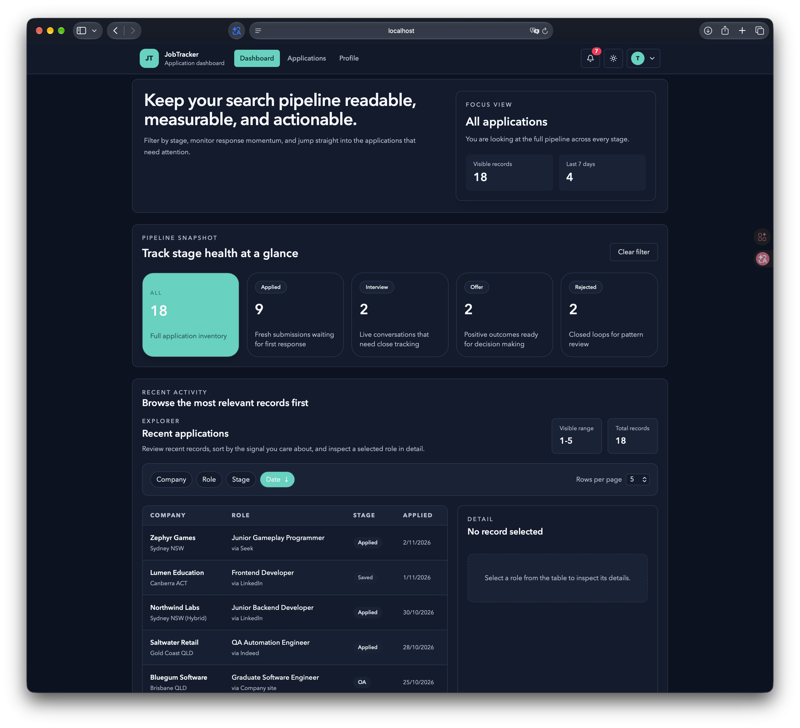
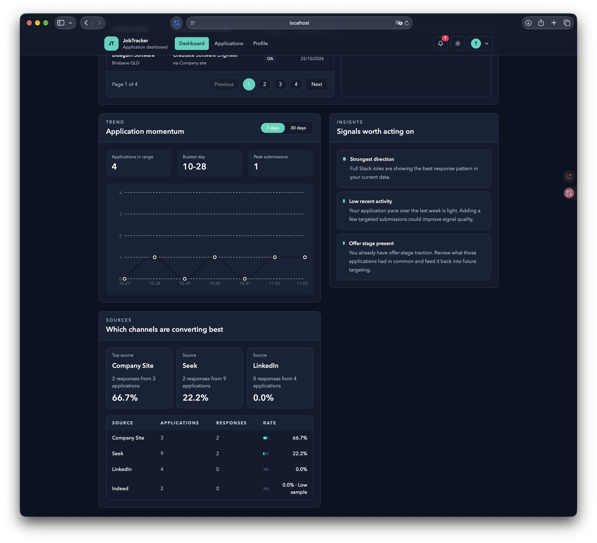

# JobTracker

JobTracker is a full-stack job application tracker for recording applications, monitoring pipeline progress, and receiving follow-up reminders.

<!-- Badge placeholders: add verified CI, deployment, or coverage badges here. -->

## Table of Contents

- [Features](#features)
- [Architecture](#architecture)
- [Tech Stack](#tech-stack)
- [Project Structure](#project-structure)
- [API Overview](#api-overview)
- [Screenshots](#screenshots)
- [Local Development](#local-development)
- [Deployment](#deployment)
- [Database Migrations](#database-migrations)
- [Sensitive Information Rules](#sensitive-information-rules)
- [Testing](#testing)
- [Troubleshooting](#troubleshooting)
- [Planned Improvements](#planned-improvements)
- [Author](#author)
- [License](#license)

## Features

### Authentication

- Email registration and password login
- Google login using a Google ID token
- JWT-based authenticated sessions
- Password change for password-based accounts
- Profile view with the configured authentication provider

### Application Tracking

- Create, edit, and delete job applications
- Track applications through multiple stages
- Store company, role, job URL, location, source, notes, and dates
- Configure follow-up dates and reminder settings
- Mark an application as followed up
- View applications in Table or Board mode
- Responsive application management layout

Supported statuses:

```text
SAVED
APPLIED
OA
INTERVIEW
OFFER
REJECTED
WITHDRAWN
```

### Reminders and Notifications

- Scheduled follow-up reminders
- In-app notifications for due follow-ups
- Unread notification count in the navigation bar
- Mark individual notifications as read
- Daily reminder processing in the configured timezone

### Dashboard

The dashboard currently includes:

- Pipeline metric cards
- Application submission trend chart
- Application source analysis
- Insights panel
- Recent application detail panel

### UI and Accessibility

- Light and dark themes
- Responsive layouts for desktop, tablet, and mobile screens
- Semantic color tokens for theme-aware surfaces, borders, text, and primary actions

## Architecture

```text
Browser
  |
  v
Vercel (React + Vite frontend)
  |
  | HTTPS REST API requests with Bearer JWT
  v
Render (Spring Boot backend)
  |
  v
Neon (PostgreSQL database)
```

For password authentication, the browser sends credentials to the Spring Boot API. The backend validates the credentials and returns a JWT. The frontend stores the token locally and sends it in the `Authorization: Bearer <token>` header for protected requests.

For Google login, the Google Identity Services button runs in the browser and returns a Google ID token. The frontend sends that token to `POST /api/auth/google`. The backend verifies the token against the configured Google client ID, creates or finds the user, and returns the application's JWT.

## Tech Stack

### Frontend

- React
- TypeScript
- Vite
- Tailwind CSS
- Recharts
- dnd-kit
- Vitest

### Backend

- Spring Boot
- Spring Security
- Spring Data JPA and Hibernate
- Flyway
- PostgreSQL
- JWT
- Bucket4j
- REST API architecture

### Deployment and Infrastructure

- Neon PostgreSQL
- Render Web Service
- Vercel

## Project Structure

```text
jobtracker/
├── src/main/java/                   # Spring Boot application code
├── src/main/resources/db/migration/ # Flyway migrations
├── jobtracker-frontend/src/         # React application
├── screenshots/                     # UI screenshots
├── Dockerfile
├── start-app.sh
├── pom.xml
└── README.md
```

## API Overview

All API paths are prefixed with `/api`. Protected endpoints require a valid Bearer JWT.

### Authentication

| Method | Path | Description |
|---|---|---|
| `POST` | `/api/auth/register` | Register with email and password. |
| `POST` | `/api/auth/login` | Log in with email and password. |
| `POST` | `/api/auth/google` | Log in with a Google ID token. |
| `GET` | `/api/auth/me` | Return the authenticated user's profile. |
| `POST` | `/api/auth/change-password` | Change the authenticated user's password. |

### Applications

| Method | Path | Description |
|---|---|---|
| `GET` | `/api/applications` | List applications for the authenticated user. |
| `GET` | `/api/applications/{id}` | Get one application owned by the authenticated user. |
| `POST` | `/api/applications` | Create an application. |
| `PATCH` | `/api/applications/{id}` | Update an application. |
| `DELETE` | `/api/applications/{id}` | Delete an application. |
| `GET` | `/api/applications/follow-ups/due` | List applications due for follow-up. |
| `POST` | `/api/applications/{id}/follow-up-done` | Mark an application's follow-up as completed. |

### Notifications

| Method | Path | Description |
|---|---|---|
| `GET` | `/api/notifications` | List notifications for the authenticated user. |
| `GET` | `/api/notifications/unread-count` | Return the authenticated user's unread notification count. |
| `PATCH` | `/api/notifications/{id}/read` | Mark a notification as read. |

## Screenshots

> TODO: update screenshots. Capture each page in both light and dark themes.

Pages to recapture:

- Login: light and dark
- Dashboard: light and dark
- Applications: light and dark
- Profile: light and dark

### Login


### Dashboard




### Applications


### Profile


## Local Development

### Run Both Applications

```bash
chmod +x start-app.sh
./start-app.sh
```

Default local URLs:

- Backend: `http://localhost:8080`
- Frontend: `http://localhost:5173`

### Backend

The tracked example configuration can be copied for local development:

```bash
cp src/main/resources/application-example.properties src/main/resources/application.properties
./mvnw spring-boot:run
```

Use a PostgreSQL connection, a JWT secret of at least 32 characters, and the Google client ID used by the frontend. The example file is a template only and must not contain real credentials.

### Frontend

```bash
cd jobtracker-frontend
npm install
cp .env.example .env
npm run dev
```

Frontend variables:

```env
VITE_API_BASE_URL=http://localhost:8080/api
VITE_GOOGLE_CLIENT_ID=your-google-client-id
```

`VITE_API_BASE_URL` selects the backend API. `VITE_GOOGLE_CLIENT_ID` must match the Google OAuth client configured for the backend.

## Deployment

Deploy in this order: Neon, Render, then Vercel.

### 1. Neon

1. Create or select the PostgreSQL project and its active database branch.
2. Copy the pooled or direct PostgreSQL connection details required by the backend.
3. Include `sslmode=require` in the JDBC URL.
4. For a new empty database, do not enable Flyway baseline mode. Flyway should run `V1__baseline.sql` normally.
5. For an existing database that already has `users`, `applications`, and `notifications` but does not have `flyway_schema_history`, use baseline mode with version `1` so the existing schema is treated as equivalent to `V1` and later migrations can run.

### 2. Render Backend

Create or reuse the existing Docker Web Service and deploy the `main` branch. Configure these variables:

| Name | Example | Description |
|---|---|---|
| `SPRING_DATASOURCE_URL` | `jdbc:postgresql://your-db-host/neondb?sslmode=require` | Neon JDBC connection URL. |
| `SPRING_DATASOURCE_USERNAME` | `your-db-user` | Neon database username. |
| `SPRING_DATASOURCE_PASSWORD` | `change-me` | Neon database password. |
| `SPRING_JPA_HIBERNATE_DDL_AUTO` | `validate` | Validate schema without changing it. |
| `SPRING_FLYWAY_ENABLED` | `true` | Enable Flyway migration processing. |
| `SPRING_FLYWAY_BASELINE_ON_MIGRATE` | `false` for a new database; `true` for an existing legacy schema | Baseline only when the existing database needs it. |
| `SPRING_FLYWAY_BASELINE_VERSION` | `1` | Required baseline version for the existing legacy schema. |
| `JWT_SECRET` | `change-me-to-a-32-character-secret` | Private JWT signing secret, at least 32 characters. |
| `GOOGLE_CLIENT_ID` | `your-google-client-id.apps.googleusercontent.com` | Google OAuth client ID verified by the backend. |
| `FRONTEND_ORIGIN` | `https://your-app.vercel.app` | Allowed browser origin. No trailing slash. Multiple origins are comma-separated. |
| `NOTIFICATIONS_CRON` | `0 0 9 * * *` | Daily notification schedule. |
| `NOTIFICATIONS_ZONE` | `Australia/Sydney` | Scheduler timezone. |
| `PORT` | Render-provided | Do not normally set manually; Render supplies the service port. |

`FRONTEND_ORIGIN` must include the scheme, must not have a trailing slash, and may contain multiple comma-separated origins:

```text
https://your-app.vercel.app,http://localhost:5173
```

After saving environment variables, deploy the latest `main` commit. The service must reach `Live` before testing the frontend.

### 3. Vercel Frontend

Configure these project variables:

| Name | Example | Description |
|---|---|---|
| `VITE_API_BASE_URL` | `https://your-render-service.onrender.com/api` | Render backend API base URL, including `/api`. |
| `VITE_GOOGLE_CLIENT_ID` | `your-google-client-id.apps.googleusercontent.com` | Google client ID used by the browser button. |

Set the Google Cloud Console OAuth client's **Authorized JavaScript origins** to include the deployed frontend origin and local development origin when needed:

```text
https://your-app.vercel.app
http://localhost:5173
```

The current Google button flow does not require a redirect URI. Variables beginning with `VITE_` are bundled into the frontend at build time. They must not contain passwords, JWT secrets, database credentials, or other private values. Changes to `VITE_` variables require a new Vercel deployment.

## Database Migrations

Migrations are stored in:

```text
src/main/resources/db/migration/
```

Use the naming format:

```text
V<version>__<description>.sql
```

Examples in this repository:

```text
V1__baseline.sql
V2__add_application_indexes_and_foreign_keys.sql
V3__rename_application_columns.sql
V4__add_auth_provider.sql
```

Migration versions must be unique and must not be edited after they have successfully run in a shared database. Add a new version for a new change. Test migrations against a database that represents the target deployment state before releasing them.

For a new empty database, leave baseline mode disabled so Flyway creates the schema from `V1`. For an existing legacy database with the application tables already present and no Flyway history table, configure `baseline-on-migrate=true` and `baseline-version=1`. This records the existing schema at `V1` and allows `V2`, `V3`, and later migrations to run.

Rollback SQL and migration recovery notes belong under:

```text
docs/
```

Rollback is not automatic. Review the migration and its rollback SQL before applying any recovery operation to a shared database.

## Sensitive Information Rules

Never commit:

- `src/main/resources/application.properties`
- Environment files containing real values
- Private key files such as `*.pem` and `*.key`
- Database passwords, JWT secrets, Google client secrets, or production connection URLs

Example files must contain placeholders only. The backend and frontend environment variables are intentionally separate: Render receives backend and database configuration, while Vercel receives only browser-safe `VITE_` values.

Variables beginning with `VITE_` are compiled into browser JavaScript and are not secret storage. Never put a database password, JWT secret, or private OAuth credential in them.

The repository includes a dependency-free pre-commit check. Enable it for this repository with:

```bash
git config core.hooksPath .githooks
```

This changes only the local repository configuration and does not change the global Git configuration.

## Testing

Backend tests:

```bash
./mvnw test
```

Frontend lint and build:

```bash
cd jobtracker-frontend
npm run lint
npm run build
```

Frontend unit tests:

```bash
cd jobtracker-frontend
npm test
```

## Troubleshooting

### CORS preflight returns 403

- Confirm the browser origin exactly matches `FRONTEND_ORIGIN`.
- Use `https://` for the deployed Vercel origin.
- Remove the trailing slash.
- For local development, include `http://localhost:5173` as a separate comma-separated origin.
- Redeploy Render after changing environment variables.
- Confirm the backend is running the latest `main` commit and allows `OPTIONS` requests.

### Google reports that the origin is not allowed for the client ID

- Add the exact Vercel origin under Google Cloud Console → OAuth client → **Authorized JavaScript origins**.
- Keep `http://localhost:5173` for local development if needed.
- Confirm `VITE_GOOGLE_CLIENT_ID` and `GOOGLE_CLIENT_ID` refer to the same client.
- Redeploy Vercel after changing the frontend variable.

### The first Render request is slow

The free Render instance may sleep when idle. The first request after sleep can take longer while the service starts. Wait for the service to become healthy before retrying.

### Flyway migration fails

- Verify the backend is connected to the intended Neon project, branch, database, and schema.
- For a new empty database, do not baseline it; let `V1` create the schema.
- For an existing schema without `flyway_schema_history`, use baseline version `1`, not `0`.
- Check the migration filename, version order, and the first database error in the Render logs.
- Do not mark a migration as successful manually or delete Flyway history without a database backup and a recovery plan.
- If a migration was partially applied, inspect the actual columns and constraints in Neon before adding a new corrective migration.

## Planned Improvements

- Resume parsing support
- Automatic source detection from job URLs
- Email notification delivery
- Migration from local storage of JWTs to HttpOnly cookies

## Author

Author: `<add author name or profile link>`

## License

License: `<add license name or repository license file>`
