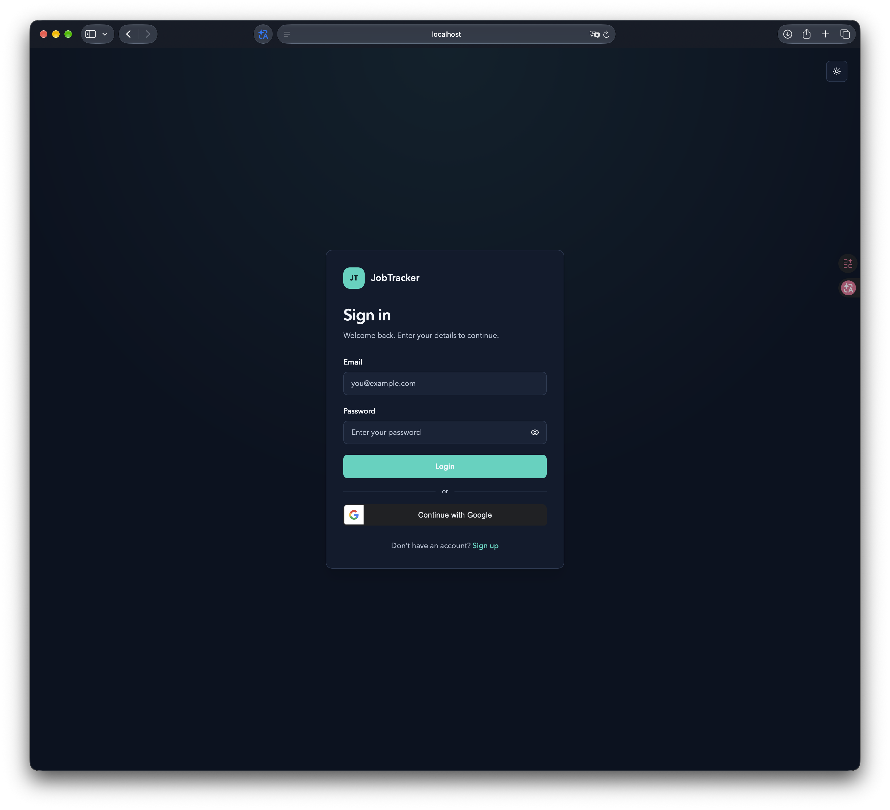
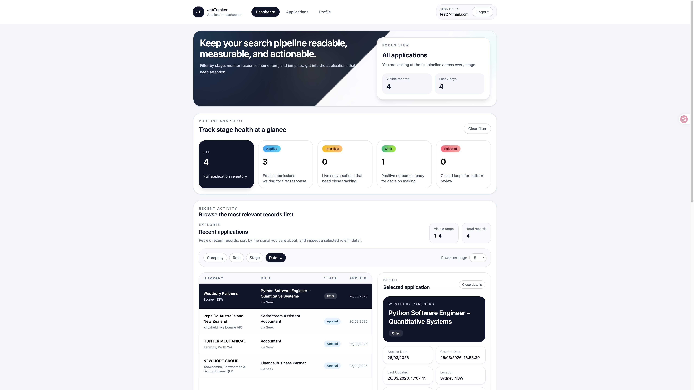
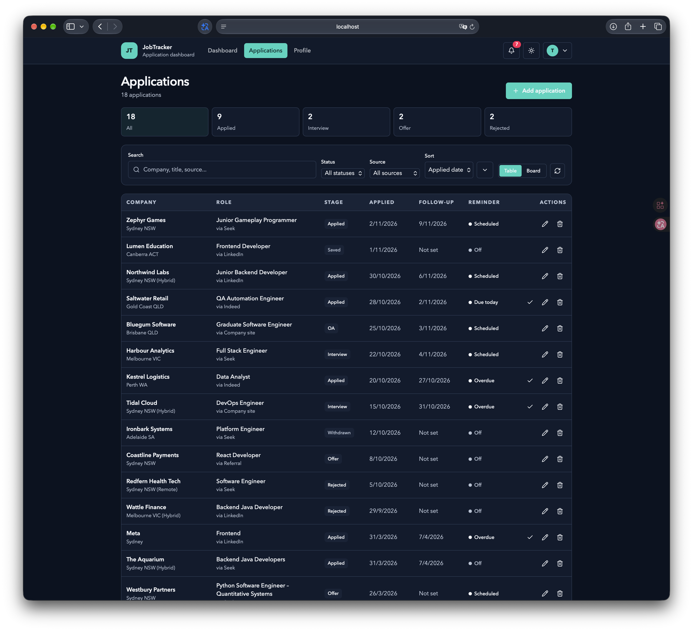
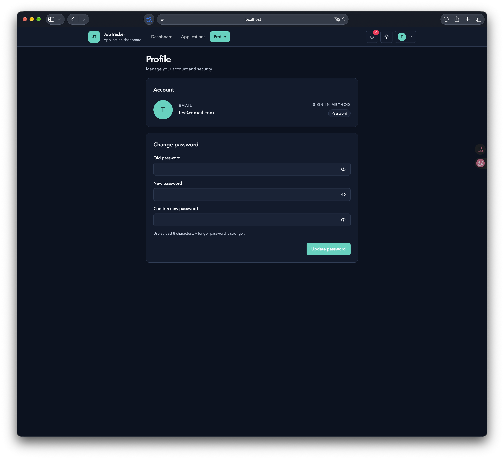

# JobTracker

JobTracker is a full-stack job application tracker built with Spring Boot and React.
It helps users capture applications, monitor pipeline health, and review progress through a cleaner dashboard workflow.

## Features

### Authentication

- Email registration and login
- Google OAuth login
- Password change for authenticated users

### Application Tracking

- Create, edit, and delete applications
- Track application progress across multiple stages
- Store source, location, notes, and job links
- Review applications from dashboard and list views

Supported statuses:

```text
SAVED
APPLIED
OA
INTERVIEW
OFFER
REJECTED
WITHDRAWN
```

Status meanings:

- `SAVED`: Role saved for later
- `APPLIED`: Submitted and waiting for first response
- `OA`: Online assessment stage
- `INTERVIEW`: Interview process in progress
- `OFFER`: Offer received
- `REJECTED`: Application closed with rejection
- `WITHDRAWN`: Application withdrawn by the user

### Dashboard

- Focus view for the current pipeline slice
- Pipeline snapshot cards for key statuses
- Recent application detail view
- Submission trend chart
- Source analysis
- Lightweight insights panel

## Screenshots

### Login



### Dashboard



### Applications



### Profile



## Tech Stack

### Frontend

- React
- TypeScript
- Vite
- Tailwind CSS

### Backend

- Spring Boot
- Spring Security
- PostgreSQL
- REST API architecture

## Project Structure

```text
jobtracker
├── src
│   └── main/java
├── jobtracker-frontend
│   └── src
├── screenshots
├── start-app.sh
├── Dockerfile
└── pom.xml
```

## Quick Start

Run backend and frontend together:

```bash
chmod +x start-app.sh
./start-app.sh
```

Default local URLs:

- Backend: `http://localhost:8080`
- Frontend: `http://localhost:5173`

## Local Setup

### Backend

Copy the tracked example and fill in local values:

```text
cp src/main/resources/application-example.properties src/main/resources/application.properties
```

The example uses environment variable placeholders:

```properties
spring.datasource.url=${DB_URL}
spring.datasource.username=${DB_USERNAME}
spring.datasource.password=${DB_PASSWORD}
jwt.secret=${JWT_SECRET}
google.client-id=${GOOGLE_CLIENT_ID}
spring.flyway.baseline-on-migrate=true
spring.flyway.baseline-version=0
```

Run:

```bash
./mvnw spring-boot:run
```

### Frontend

```bash
cd jobtracker-frontend
npm install
cp .env.example .env
npm run dev
```

Frontend environment variables:

```env
VITE_API_BASE_URL=http://localhost:8080/api
VITE_GOOGLE_CLIENT_ID=
```

Notes:

- `VITE_API_BASE_URL` controls which backend API the frontend talks to
- `VITE_GOOGLE_CLIENT_ID` should match the Google OAuth client configured for the backend
- Frontend routes include `/login`, `/dashboard`, `/applications`, and `/profile`

## Sensitive information rules

Never commit `src/main/resources/application.properties`, `application-*.properties` other than `application-example.properties`, `.env` files other than `.env.example`, `*.pem`, or `*.key`. Build output, logs, `node_modules`, `target`, `dist`, coverage reports, IDE files, and OS metadata are also ignored. Example files must contain placeholders only, such as `your-db-host` or `change-me`.

Flyway is configured with `spring.flyway.baseline-on-migrate=true` and `spring.flyway.baseline-version=0` in the example configuration. Verify the intended baseline before deploying to a new database.

### Render backend variables

- `SPRING_DATASOURCE_URL`: private Neon PostgreSQL JDBC URL, including `sslmode=require`
- `SPRING_DATASOURCE_USERNAME`: Neon database username
- `SPRING_DATASOURCE_PASSWORD`: Neon database password
- `SPRING_JPA_HIBERNATE_DDL_AUTO`: use `validate` with Flyway
- `SPRING_FLYWAY_BASELINE_ON_MIGRATE`: use `true` when the baseline strategy is intended
- `SPRING_FLYWAY_BASELINE_VERSION`: use `0` for this project baseline
- `JWT_SECRET`: strong private signing secret, at least 32 characters
- `GOOGLE_CLIENT_ID`: Google OAuth client ID used by the backend
- `FRONTEND_ORIGIN`: deployed Vercel frontend origin
- `PORT`: Render-provided port when applicable
- `NOTIFICATIONS_CRON`: notification scheduler expression
- `NOTIFICATIONS_ZONE`: scheduler timezone, for example `Australia/Sydney`

### Vercel frontend variables

- `VITE_API_BASE_URL`: deployed Render API base URL, including `/api`
- `VITE_GOOGLE_CLIENT_ID`: Google OAuth client ID for the browser

Variables beginning with `VITE_` are bundled into browser JavaScript. Do not put database passwords, JWT secrets, Google client secrets, or any other private credential in them.

### Enable the local pre-commit check

The repository includes a dependency-free hook that blocks common sensitive files and values:

```bash
git config core.hooksPath .githooks
```

This changes only the current repository. It does not modify global Git configuration.

## Testing

Backend:

```bash
./mvnw test
```

Frontend:

```bash
cd jobtracker-frontend
npm test
```

## Example Use Cases

- Organize ongoing job applications in one place
- Track response progress across different stages
- Review application activity trends
- Compare which sources produce stronger outcomes

## Planned Improvements

- Resume parsing support
- Automatic source detection from job URLs
- Reminder and follow-up workflows
- Cloud deployment support

## Author👨🏻‍💻
# Environment variables

For local or Render deployments, configure `SPRING_DATASOURCE_URL`,
`SPRING_DATASOURCE_USERNAME`, `SPRING_DATASOURCE_PASSWORD`, `JWT_SECRET`,
`GOOGLE_CLIENT_ID`, `FRONTEND_ORIGIN`, `PORT`,
`NOTIFICATIONS_CRON`, and `NOTIFICATIONS_ZONE`. The JDBC URL must use
`jdbc:postgresql://...` and Neon connections should include `sslmode=require`.

The backend runs with `./mvnw spring-boot:run`. The frontend runs from
`jobtracker-frontend` with `npm run dev`. Windows users can use `mvnw.cmd
spring-boot:run` and run the frontend command from PowerShell.
